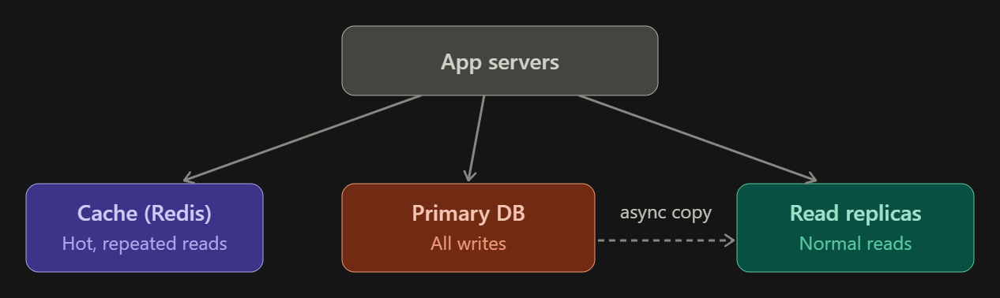
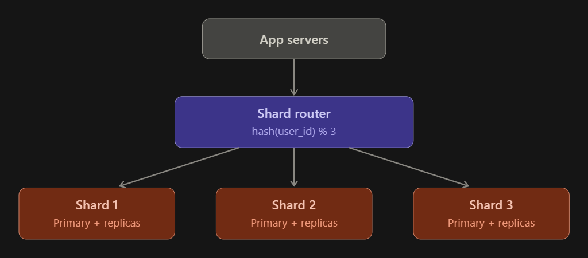
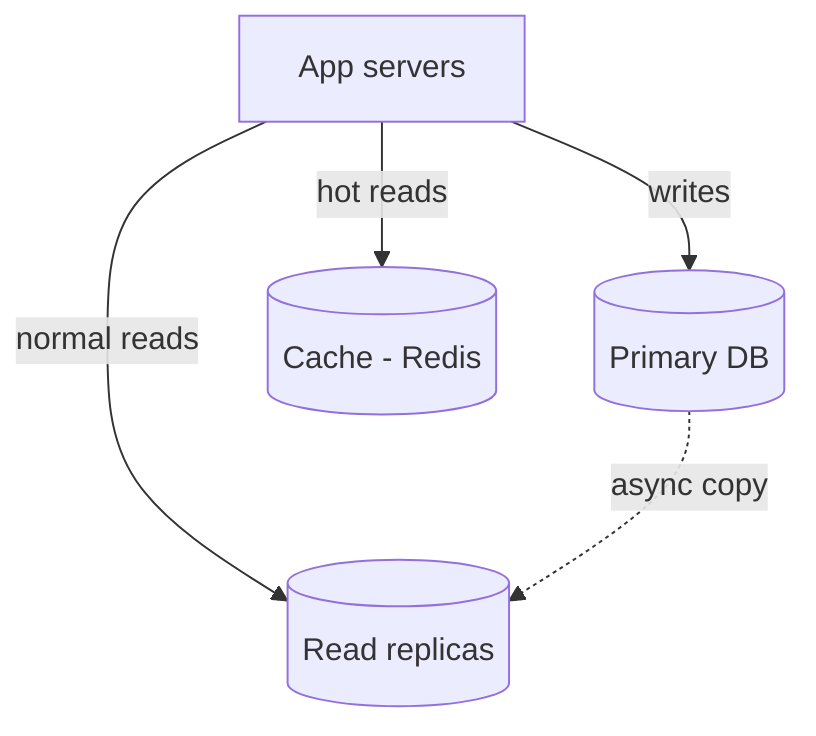
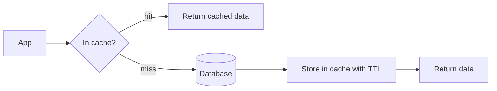
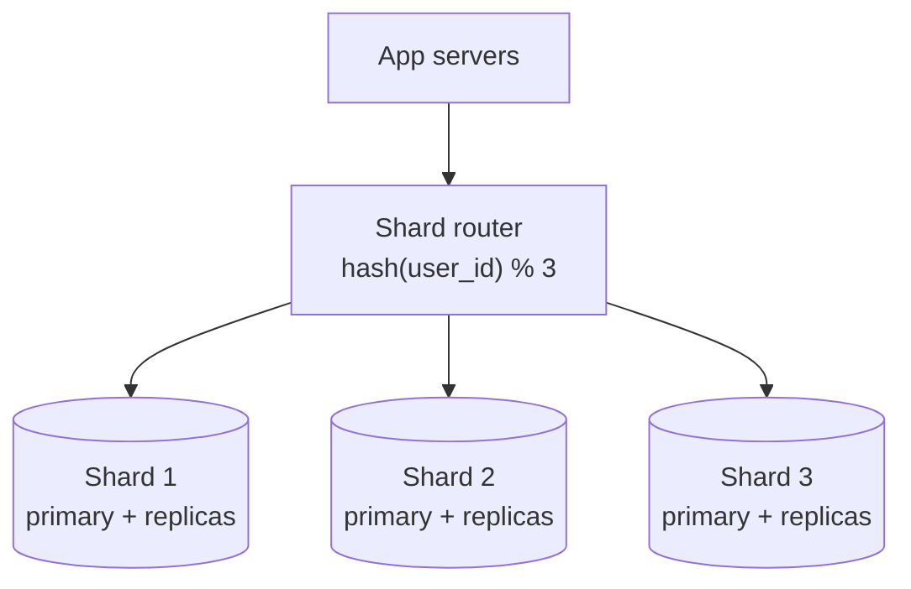

# CCTV Alerts API (Django + DRF + JWT + ASGI)

## Setup
```bash
python -m venv venv && source venv/bin/activate     # Windows: venv\Scripts\activate
pip install -r requirements.txt
python manage.py migrate
python manage.py createsuperuser
```

## Run (ASGI)
```bash
uvicorn config.asgi:application --host 0.0.0.0 --port 8000 --reload
```
(Alternative: `pip install daphne && daphne config.asgi:application -p 8000`)

## APIs
| Method | URL | Auth | Purpose |
|---|---|---|---|
| POST | /api/auth/register/ | no | create user (optional, remove if not needed) |
| POST | /api/auth/login/ | no | returns `access` (1 hour) + `refresh` (1 day) |
| POST | /api/auth/refresh/ | no | new access token using `refresh` |
| POST | /api/alerts/ | Bearer | send image + alert data (saved to DB) |
| GET  | /api/alerts/ | Bearer | list alerts, filters `?camera_no=1&alert_name=person` |

### Login
```bash
curl -X POST http://localhost:8000/api/auth/login/ -d username=admin -d password=admin123
```

### Send alert (multipart)
```bash
curl -X POST http://localhost:8000/api/alerts/ \
  -H "Authorization: Bearer <ACCESS_TOKEN>" \
  -F image=@frame.jpg \
  -F alert_names=person -F alert_names=vehicle \
  -F camera_no=CAM-1 \
  -F alert_time=2026-10-24T10:30:00Z
```
`alert_names` also accepts `person,vehicle` or `["person","vehicle"]`.

## Table: alerts_alert
| Column | Description |
|---|---|
| image | uploaded image path (media/alerts/YYYY/MM/DD/) |
| alert_names | list, e.g. ["person","vehicle"] |
| camera_no | camera number |
| alert_time | when the alert happened |
| created_date | when row was saved (auto) |


# DATABASE SCALLING

## DATBASE REPLICA ( Read | Write )



## SHARDING



# Database Horizontal Scaling
 
A practical guide to scaling a database as traffic grows: read replicas, replication lag, caching, and sharding (user_id vs country).
 
## Table of contents
 
- [Overview](#overview)
- [Step 1: Know your traffic](#step-1-know-your-traffic)
- [Step 2: Read replicas](#step-2-read-replicas)
- [Step 3: Caching](#step-3-caching)
- [Step 4: Sharding](#step-4-sharding)
- [Choosing a shard key](#choosing-a-shard-key)
- [Sharding methods](#sharding-methods)
- [Trade-offs of sharding](#trade-offs-of-sharding)
- [Summary](#summary)
## Overview
 
The scaling journey, in order:
 
1. Optimize first: indexes, query tuning, a bigger machine.
2. Add read replicas to scale reads. Handle lag by reading from the primary right after a write.
3. Add a cache for hot, continuously read data.
4. Shard by hashed `user_id` when writes or data size outgrow one primary.
## Step 1: Know your traffic
 
Most apps are read-heavy, often 90 to 99% reads (people view posts far more than they create them). Reads and writes are scaled differently, so measure the read/write ratio first.
 
## Step 2: Read replicas
 
One **primary** database takes all writes. It copies data to one or more **read replicas**, and the app sends read queries to the replicas.
 

 
### The problem: replication lag
 
The copy from primary to replica is asynchronous, so it takes milliseconds (sometimes seconds). This causes a classic bug:
 
1. User creates a post. It is written to the primary.
2. The page refreshes and reads from a replica.
3. The replica has not received the post yet, so the result is "post not found".
### The fix: read-your-writes
 
- After a user writes, read **their own recent data** from the primary. For example, for the next 5 to 10 seconds, route that user's reads to the primary. Store a flag or timestamp in the session or cache.
- Everyone else reads from replicas. Seeing a post 1 second late is fine.
- Critical reads (payment status, balance) always go to the primary.
## Step 3: Caching
 
Some data is read again and again: the home feed, a viral post, a profile, like counts. Do not hit the database for each read.
 

 
This is the **cache-aside** pattern.
 
- Set a **TTL** so data does not stay stale forever.
- On update, delete or refresh the cache key.
- For a very hot key (a celebrity post), use a short TTL with a lock or request coalescing, so thousands of simultaneous misses do not all hit the DB.
Cache absorbs most reads, replicas take the rest, and the primary stays free for writes.
 
## Step 4: Sharding
 
Replicas and cache do not help with writes, because every write still goes to one primary. When that primary can no longer handle the write volume or storage, split the data across several databases. This is **sharding** (horizontal partitioning). Each shard is its own primary, with its own replicas, and holds only part of the data.
 

 
## Choosing a shard key
 
**Recommendation: use `user_id` (hashed).** A good shard key has three properties:
 
1. **High cardinality**: many distinct values, so data can spread.
2. **Even distribution**: no shard gets far more load than the others.
3. **Present in most queries**: so a query hits one shard, not all of them.
| | `user_id` (hash) | `country` |
|---|---|---|
| Distribution | Even, hashing spreads users randomly | Very skewed. India or the US can be 100x a small country |
| Hot shard | Rare | Common. One country's shard overloads while others idle |
| Max shards | As many as you want | Capped at about 200 countries |
| Query routing | Most queries are per-user, so they hit 1 shard | Works only if users never cross countries |
| Resharding | Possible with consistent hashing | A big country cannot be split without a second key |
 
### When country is useful
 
Country fits **data residency laws** (GDPR, India's data rules) or latency goals. Use two levels: pick the region cluster by country, then shard by `user_id` inside it.
 
## Sharding methods
 
| Method | How it works | Pros | Cons |
|---|---|---|---|
| Hash-based | `shard = hash(user_id) % N` | Most even, best default | Changing N moves most data. Use consistent hashing or many virtual shards (for example 1024 logical shards on a few servers) |
| Range-based | user_id 1 to 1M on shard 1, and so on | Simple, good for range scans | Newest users all hit the last shard (hot spot) |
| Directory-based | A lookup table of `user_id` to shard | Flexible, can move big users | Lookup service is an extra dependency (cache it) |
 
## Trade-offs of sharding
 
- **Cross-shard queries and joins** are slow and complex. Design so most queries stay within one user's shard.
- **Cross-shard transactions** are hard. Avoid them or use sagas.
- **Resharding** is painful. Plan the logical shard count early.
- **Keep related data together.** A user's posts, likes and comments should share the same `user_id` key so they live on the same shard.
- **Celebrity hot shards** can still happen. Use cache or a dedicated shard for very large accounts.
## Summary
 
| Problem | Solution |
|---|---|
| Slow queries | Indexes, query tuning, bigger machine |
| Too many reads | Read replicas |
| Stale read after write | Read from primary for that user for a few seconds |
| Same data read repeatedly | Cache with TTL |
| Writes or data too big for one DB | Shard by hashed `user_id` |
| Data residency rules | Region by country, then shard by `user_id` |
 
## License
 
MIT